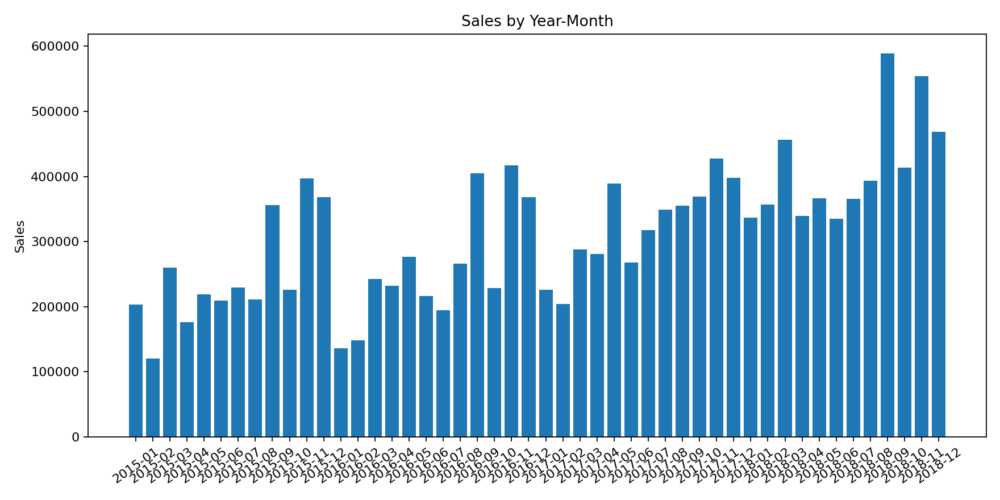
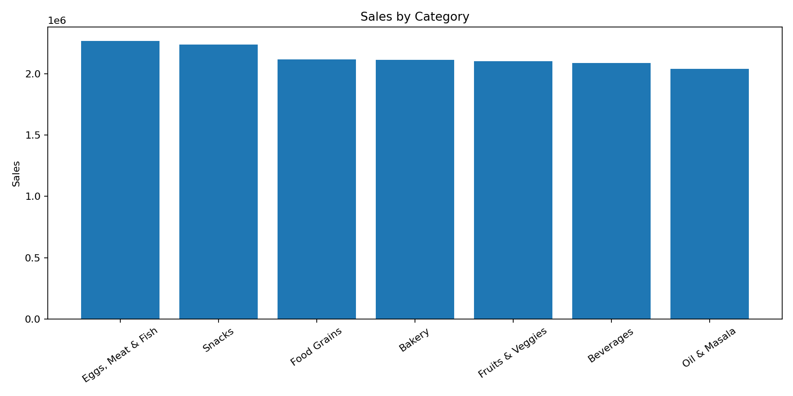
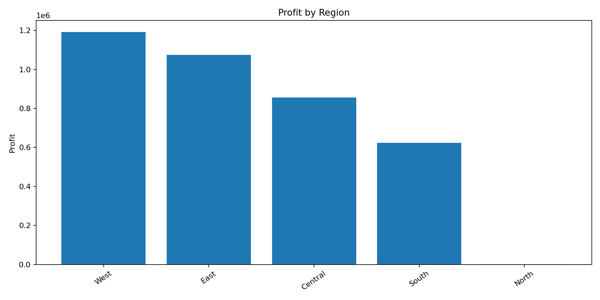
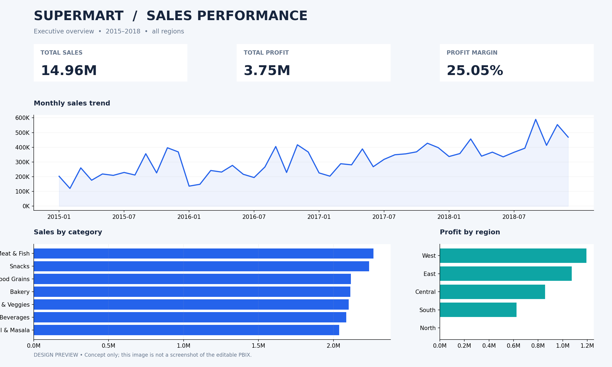

# Supermart Grocery Sales — Sales & Profitability Analysis

Python · Pandas · Matplotlib · Power BI | Data analysis / BI portfolio project

## Project overview

This project explores retail sales transactions to understand revenue and profitability across product categories, geographical regions and time. It also examines whether discount levels are associated with profit. Data transformation and exploratory analysis are performed in Python; Power BI is used for interactive business reporting.

**Status:** Python analysis executed successfully on the original CSV. The Power BI file included in this repository is the **original coursework report**, not a redesigned final dashboard. Theme, DAX measures and a design concept are supplied for a **manual Power BI Desktop upgrade**.

## Key results

| Metric | Value |
| --- | ---: |
| Sales records | 9,994 |
| Distinct order IDs | 9,994 |
| Total sales | 14,956,982 |
| Total profit | 3,747,121.20 |
| Overall profit margin | 25.05% |

In the analyzed dataset, **November** has the highest total sales when months are pooled across the four years (2015–2018). **September 2018** is the highest individual year-month. **Eggs, Meat & Fish** is the highest-sales category; **West** is the highest-sales region. The Pearson correlation between `Discount` and `Profit` is approximately zero at the row level; this does **not** establish the causal effect of discounting.

> Values are in the units recorded in the dataset; no currency conversion has been applied. Rows are sales records, not necessarily quantities of items. The CSV has **no Quantity field**.

## Analysis visuals







### Power BI redesign concept



*This is a design mockup, not a screenshot of the current Power BI report.*

## Technology & methods

- Python with Pandas for data validation, date parsing, aggregations, profitability metrics and correlation analysis.
- Matplotlib for charts, with summary tables exported to CSV.
- Power BI for reporting; proposed DAX measures include total sales, profit, profit margin, distinct orders and year-over-year change.
- Data-quality checks for missing fields, missing values, duplicates and invalid dates.

## Source data

Dataset: [Supermart Grocery Sales – Retail Analytics Dataset](https://www.kaggle.com/datasets/mohamedharris/supermart-grocery-sales-retail-analytics-dataset) (M. Harris; refer to the dataset page for licensing and attribution).

The raw data file is **not redistributed in this repository**. Download it from the dataset page and save the CSV as `Supermart Grocery Sales - Retail Analytics Dataset.csv` in the root folder, or use `--input` to point to another location.

**Date parsing:** Hyphen-separated dates are treated as `DD-MM-YYYY`, and slash-separated dates as `MM/DD/YYYY`, following the observed conventions in this dataset. Treat this as a dataset-specific assumption when adapting the script.

## How to run

```bash
python -m venv .venv
# Windows: .venv\Scripts\activate
# macOS/Linux: source .venv/bin/activate
pip install -r requirements.txt
python src/sales_analysis.py --input "Supermart Grocery Sales - Retail Analytics Dataset.csv" --output sales_analysis_output
```

Generated CSV summaries and PNG charts will be written to `sales_analysis_output/`. Example output summaries and selected charts from the verified run are included under `results/` and `assets/`.

## Power BI steps

1. Open `powerbi/Original_projekt.pbix` in Power BI Desktop and save a working copy.
2. Follow `powerbi/PowerBI_Setup_Guide.md`, which details source refresh, calendar table, relationships and validation checks. Use a prepared CSV from the prior Power BI upgrade package or add the correct date transformations in Power Query.
3. Import `powerbi/Supermart_Theme.json` and add the formulas in `powerbi/DAX_Measures.txt` and `powerbi/DAX_Calendar.txt` individually.
4. Validate totals against the table above. Replace the concept image with actual screenshots only after the dashboard is finished.

The PBIX has **not** been modified by this repository generation step.

## Folder structure

```text
Supermart_Sales_GitHub_Portfolio/
├── README.md
├── requirements.txt
├── .gitignore
├── src/sales_analysis.py
├── results/                 # Selected reproducible output summaries
├── assets/                  # Generated charts and labeled design concept
└── powerbi/
    ├── Original_projekt.pbix
    ├── PowerBI_Setup_Guide.md
    ├── DAX_Measures.txt
    ├── DAX_Calendar.txt
    └── Supermart_Theme.json
```

## Limitations & next steps

- The analysis is descriptive: neither correlation nor grouped totals prove why performance changes.
- `Customer Name` may not be a stable unique customer identifier.
- Pricing, inventory, advertising and quantity data are unavailable, limiting explanations of sales changes.
- The dataset covers historical transactions and does not provide a basis for claims about current retail demand.
- The Power BI redesign should be implemented and checked manually in Power BI Desktop, then documented with actual report screenshots.
